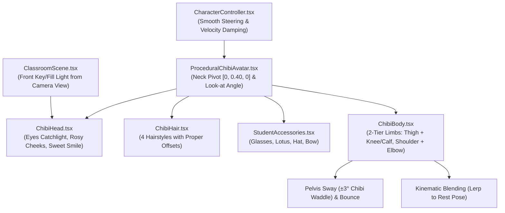

# 📋 Kế Hoạch Triển Khai: Nâng Cấp Toàn Diện Hệ Thống Animation & Rigging Nhân Vật Chibi 3D

> **Mục tiêu tối thượng**:
> 1. Xóa bỏ hoàn toàn hiện tượng gù gập, chúi đầu xuống sàn và mặt bị tối thui như ghi nhận trong [`IMG_3216.jpeg`](file:///home/antigravity/IMG_3216.jpeg).
> 2. Xây dựng hệ thống khớp động học 2 tầng (2-Tier Articulated Limbs) cho Chibi: có khớp gập gối tự nhiên khi bước đi và khớp gập khuỷu tay mềm mại.
> 3. Tích hợp chuyển động lắc hông Chibi Waddle và nhấp nhô cơ thể tự nhiên.
> 4. Cơ chế nội suy chuyển trạng thái (Smooth State Blending/Lerping) loại bỏ hoàn toàn hiện tượng kẹt dáng đứng (frozen walk cycle).
> 5. Nâng cấp chiếu sáng trực diện (Front Face Fill Light) giúp ngũ quan anime (mắt ngọc obsidian catchlight, má hồng, nụ cười) luôn rực rỡ, thu hút người xem livestream TikTok.

---

## 🏗️ 1. Phân Tích Kiến Trúc Kỹ Thuật

---

## 🛠️ 2. Chi Tiết Kế Hoạch Chỉnh Sửa Từng Component

### Component 1: Khắc phục Trục Xoay Cổ & Góc Nhìn ([`ProceduralChibiAvatar.tsx`](file:///home/antigravity/classroom-3d/src/components/3d/avatar/ProceduralChibiAvatar.tsx) & [`ChibiHead.tsx`](file:///home/antigravity/classroom-3d/src/components/3d/avatar/ChibiHead.tsx))
* **Vấn đề cũ**: `headGroupRef` đặt ở $[0, 0, 0]$ (dưới sàn), làm đầu bị văng xa $16\text{cm}$ ra trước ngực khi xoay $X$.
* **Giải pháp**:
  - Đặt `headGroupRef` tại đúng khớp cổ: `position={[0, 0.40, 0]}`.
  - Chuyển gốc tọa độ bên trong `ChibiHead.tsx` và `ChibiHair.tsx` về quanh tâm $[0, 0.05, 0]$ (thay vì $[0, 0.46, 0]$).
  - Góc nghiêng mặc định (`IDLE`): $+0.08\text{rad} \approx +4.5^\circ$ (ngẩng nhẹ lên hướng về camera), không bao giờ chúc xuống sàn.
  - Góc nghiêng suy nghĩ (`THINKING`): Nghiêng đầu nhẹ sang bên $\text{rot.z} = 0.12$, ngước lên $+0.06$.
  - Góc buồn (`SAD`): Cúi nhẹ tại đốt cổ $-0.12\text{rad}$, giữ nguyên đầu gắn liền trên cổ áo chứ không tách rời.
  - Bổ sung hiệu ứng chớp mắt tự nhiên (procedural blink) theo chu kỳ $3.5\text{s}$.

### Component 2: Nâng cấp Khung Xương 2 Tầng & Chu Kỳ Bước Đi ([`ChibiBody.tsx`](file:///home/antigravity/classroom-3d/src/components/3d/avatar/ChibiBody.tsx))
* **Vấn đề cũ**: Cẳng chân và cẳng tay là khối thẳng cứng, chỉ xoay ở hông và vai.
* **Giải pháp**:
  - Tạo refs cho khớp gối: `leftCalfRef`, `rightCalfRef`.
  - Tạo refs cho khớp khuỷu tay: `leftForearmRef`, `rightForearmRef`.
  - **Khi di chuyển (`isWalking = true`)**:
    - Chân vung ra sau: Cẳng chân gập lên $\text{kneeAngle} = \max(0, -\text{legAngle}) \times 0.9$ (mô phỏng nhấc gót chân tự nhiên).
    - Chân bước ra trước: Chân duỗi thẳng tiếp đất tự nhiên.
    - Cánh tay: Khuỷu tay gập $25^\circ - 40^\circ$, đánh tay nhịp nhàng so le với bước chân.
    - Hông: Lắc hông Chibi Waddle quanh trục $Z$ ($\pm 0.06\text{rad}$), tạo dáng đi bập bùng ngộ nghĩnh.
    - Nhấp nhô cơ thể: $\text{bounceY} = |\sin(\text{walkCycle})| \times 0.035$.
  - **Khi dừng lại (`isWalking = false`)**:
    - Sử dụng `THREE.MathUtils.damp()` hoặc nội suy `lerp` để các góc xoay chân, tay, hông thu về tư thế chuẩn `REST_POSE` trong $0.15\text{s}$.
    - Không bị giật khựng hoặc kẹt ở tư thế bước chân dở dang.

### Component 3: Mượt Hóa Chuyển Hướng & Di Chuyển ([`CharacterController.tsx`](file:///home/antigravity/classroom-3d/src/components/3d/CharacterController.tsx))
* **Vấn đề cũ**: Ngắt chuyển động tức thì khi chạm bán kính $0.06\text{m}$.
* **Giải pháp**:
  - Giảm tốc mượt (easing out) khi đến gần đích ($< 0.4\text{m}$).
  - Chuyển hướng quay mặt (yaw) xoay mượt mà với damping factor hợp lý.
  - Tại Quiz Zone, nhân vật xoay đúng góc nhìn về phía camera để khoe diện mạo và biểu cảm.

### Component 4: Chiếu Sáng Trực Diện Bừng Sáng Ngũ Quan ([`ClassroomScene.tsx`](file:///home/antigravity/classroom-3d/src/components/3d/ClassroomScene.tsx))
* **Vấn đề cũ**: Ánh sáng ngược và góc xiên làm mặt nhân vật tối sầm.
* **Giải pháp**:
  - Thêm một nguồn sáng dịu từ phía trước camera:
    `<directionalLight position={[0, 2.5, -5]} intensity={0.7} color="#ffffff" />`
  - Đảm bảo tròng mắt obsidian, hạt catchlight trắng và má hồng luôn bắt sáng rõ nét trên mọi thiết bị di động.

---

## 🧪 3. Quy Trình Kiểm Thử & Nghiệm Thu (Verification Checklist)

1. [ ] **Build Check**: Chạy `npm run build` thành công, không có bất kỳ cảnh báo hoặc lỗi type nào.
2. [ ] **Visual Screenshot Audit**:
   - Chạy script chụp ảnh thực tế các góc cận cảnh nhân vật tại Quiz Zone và bục giảng.
   - Dùng tool `view_file` kiểm tra trực tiếp:
     - [ ] Đầu gắn khít với cổ, không bị lệch hoặc văng ra ngoài thân áo.
     - [ ] Mặt ngẩng nhẹ tươi tắn hướng về camera, bắt sáng rực rỡ.
     - [ ] Chân tay có khớp gối, khớp khuỷu gập tự nhiên.
     - [ ] Khi đứng yên, tư thế thăng bằng vững chãi, hai chân khép gọn.
3. [ ] **Git Sync**: Commit toàn bộ code mới với thông điệp rõ ràng và push lên `origin/main`.
4. [ ] **Deploy & E2E Verification**: Kích hoạt pipeline triển khai lên Cloudflare Pages và kiểm tra môi trường production trực tuyến.
