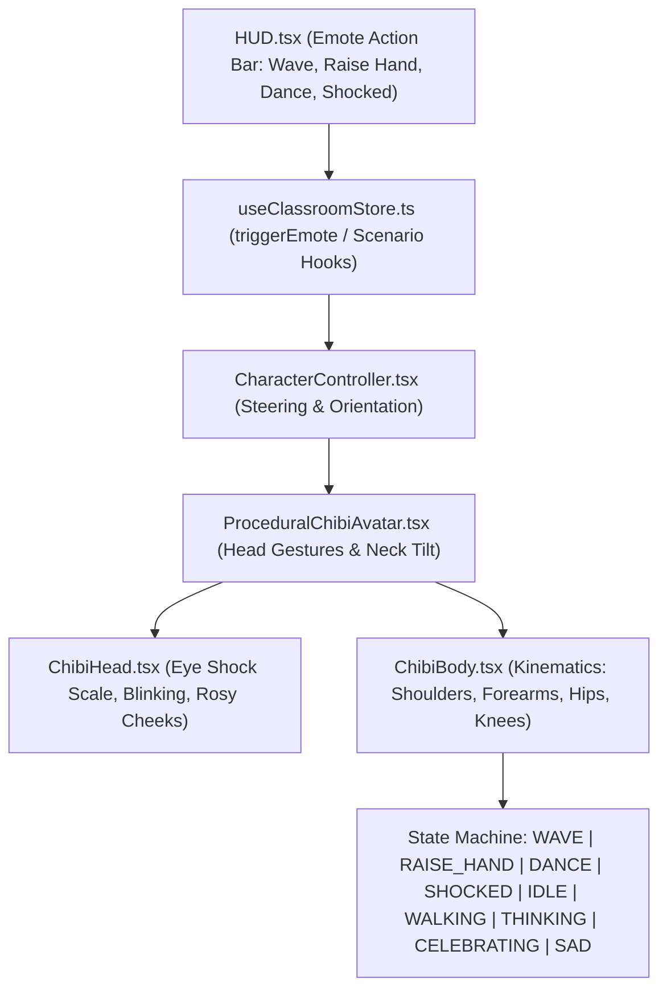

# 📋 Kế Hoạch Triển Khai: Tích Hợp Bộ Hoạt Ảnh Sống Động Mới (WAVE, RAISE_HAND, DANCE, SHOCKED) Cho 20 Nhân Vật Chibi 3D

> **Mục tiêu**:
> 1. Mở rộng hệ thống animation của 20 nhân vật Chibi với **4 cử chỉ & biểu cảm mới cực kỳ sống động và tương tác cao** chuẩn livestream TikTok:
>    - 👋 **`WAVE` (Vẫy tay chào khán giả)**: Cả lớp đồng thanh vẫy tay chào người xem khi vào phòng hoặc bấm nút Chào.
>    - 🙋 **`RAISE_HAND` (Giơ tay xin phát biểu)**: Các bạn giơ cao một tay lên xin quyền trả lời câu hỏi bài học.
>    - 💃 **`DANCE` (Nhảy múa quẩy nhiệt tình)**: Lắc hông hai bên, vung tay đổi chiều vui nhộn ăn mừng thành tích cao.
>    - 😱 **`SHOCKED` (Giật mình hốt hoảng / Vine Boom)**: Hai tay ôm má/đầu, giật lùi nhẹ mắt mở to khi gặp câu hỏi bất ngờ hoặc bẫy khó.
> 2. Nâng cấp thanh công cụ điều khiển **HUD** với cụm nút tương tác nhanh (Emote Action Bar) cho phép streamer/người dùng kích hoạt biểu cảm cho cả lớp hoặc kết hợp vào kịch bản tự động.
> 3. Tích hợp hiệu ứng âm thanh SFX đồng bộ (`vine_boom`, `whoosh_fast`, `cat_huh`, `pop_mouth`).

---

## 🏗️ 1. Kiến Trúc Chuyển Động & Phân Cấp Khớp Xương



---

## 🛠️ 2. Chi Tiết Kế Hoạch Chỉnh Sửa Từng Component

### Component 1: Mở rộng Kiểu Trạng Thái & Dữ Liệu ([`src/types/classroom.ts`](file:///home/antigravity/classroom-3d/src/types/classroom.ts))
* Mở rộng `CharacterState` bao gồm:
  ```typescript
  export type CharacterState =
    | 'IDLE'
    | 'WALKING'
    | 'THINKING'
    | 'CELEBRATING'
    | 'SAD'
    | 'WAVE'
    | 'RAISE_HAND'
    | 'DANCE'
    | 'SHOCKED';
  ```

---

### Component 2: Nâng Cấp Động Học Khung Xương ChibiBody ([`src/components/3d/avatar/ChibiBody.tsx`](file:///home/antigravity/classroom-3d/src/components/3d/avatar/ChibiBody.tsx))
Xây dựng toán học chuyển động 2 tầng (Shoulder, Elbow, Pelvis, Knee) cho 4 hoạt ảnh mới:

1. 👋 **`WAVE` (Vẫy tay chào)**:
   - Tay phải nâng cao qua vai: $\text{rot.z} = -2.2$, khuỷu tay gập $-0.45\text{rad}$.
   - Cẳng tay phải vẫy qua lại nhịp nhàng: $\text{rot.z} = -2.2 + \sin(\text{time} \times 10 + \text{seed}) \times 0.35$.
   - Tay trái chống nhẹ bên hông tự nhiên ($\text{rot.z} = -0.2$).
   - Thân người nghiêng nhẹ sang bên theo nhịp vẫy.

2. 🙋 **`RAISE_HAND` (Giơ tay xin phát biểu)**:
   - Tay phải giơ thẳng đứng lên cao sát tai: $\text{rot.z} = -2.85$, khuỷu duỗi thẳng tự nhiên.
   - Bàn tay nhấp nhô nhẹ ($\sin(\text{time} \times 5) \times 0.08$) thể hiện sự hăng hái xung phong.
   - Tay trái buông tự nhiên hoặc giữ sách/bàn.
   - Thân người rướn cao lên $+1.5\text{cm}$.

3. 💃 **`DANCE` (Vũ đạo Chibi vui nhộn)**:
   - Hông lắc lư sang hai bên biên độ lớn: $\text{rot.z} = \sin(\text{time} \times 8 + \text{seed}) \times 0.12$.
   - Hai tay vung so le gập khuỷu tay $90^\circ$ theo nhịp disco:
     - Tay trái: $\text{rot.x} = \sin(\text{time} \times 8) \times 0.6$, $\text{elbow} = -0.9$.
     - Tay phải: $\text{rot.x} = -\sin(\text{time} \times 8) \times 0.6$, $\text{elbow} = -0.9$.
   - Đầu gối nhún nhảy bập bùng: $\text{bounceY} = |\sin(\text{time} \times 8)| \times 0.05$.

4. 😱 **`SHOCKED` (Giật mình hốt hoảng)**:
   - Hai tay co giật đưa lên ôm hai bên má/đầu: $\text{rot.x} = -1.6$, $\text{rot.z} = \pm 0.8$, $\text{elbow} = -1.4$.
   - Cơ thể giật lùi nhẹ về sau một nhịp và run nhẹ: $\text{jitter} = \sin(\text{time} \times 35) \times 0.008$.
   - Đồng bộ SFX `vine_boom` tạo tiếng nổ meme TikTok.

---

### Component 3: Nâng Cấp Cử Động Đầu & Mắt ([`src/components/3d/avatar/ProceduralChibiAvatar.tsx`](file:///home/antigravity/classroom-3d/src/components/3d/avatar/ProceduralChibiAvatar.tsx) & [`ChibiHead.tsx`](file:///home/antigravity/classroom-3d/src/components/3d/avatar/ChibiHead.tsx))
* **Trong `ProceduralChibiAvatar.tsx`**:
  - `WAVE`: Đầu nghiêng nhẹ $+6^\circ$ nhìn thẳng camera mỉm cười.
  - `RAISE_HAND`: Đầu ngẩng cao $+12^\circ$ mắt sáng hướng lên bảng.
  - `DANCE`: Đầu lắc lư theo nhịp nhạc $\sin(\text{time} \times 8) \times 0.1$.
  - `SHOCKED`: Đầu giật ngửa ra sau $-10^\circ$, lắc run rẩy.
* **Trong `ChibiHead.tsx`**:
  - Khi `SHOCKED`: Mắt anime mở to gấp $1.35$ lần (đồng tử giãn), miệng mở hình tròn $O$ kinh ngạc.

---

### Component 4: Quản Lý Trạng Thái & SFX ([`src/hooks/useClassroomStore.ts`](file:///home/antigravity/classroom-3d/src/hooks/useClassroomStore.ts))
* Bổ sung các phương thức điều khiển:
  - `triggerWaveAll()`: Toàn bộ 20 bạn vẫy tay chào trong $3.5\text{s}$, phát âm thanh `pop_mouth`.
  - `triggerRaiseHandAll()`: 20 bạn cùng giơ tay xung phong trong $3.0\text{s}$, phát âm thanh `click_ui`.
  - `triggerDanceAll()`: 20 bạn cùng quẩy vũ đạo trong $4.0\text{s}$, phát âm thanh `rizz_sound` / `coin_reward`.
  - `triggerShockedAll()`: 20 bạn cùng giật mình ôm đầu, phát âm thanh `vine_boom`.

---

### Component 5: Cụm Nút Emote Trên HUD ([`src/components/ui/HUD.tsx`](file:///home/antigravity/classroom-3d/src/components/ui/HUD.tsx))
* Bổ sung hàng nút phụ hoặc popover hành động nhanh (Action Emote Bar) với các icon trực quan:
  - 👋 **Chào** (`WAVE`)
  - 🙋 **Xung Phong** (`RAISE_HAND`)
  - 💃 **Nhảy Múa** (`DANCE`)
  - 😱 **Bất Ngờ** (`SHOCKED`)
* Giao diện tối ưu chuẩn cảm ứng điện thoại di động, tự động co giãn không che lấp nội dung chính.

---

## 🧪 3. Kế Hoạch Kiểm Thử & Nghiệm Thu (Verification Plan)

### A. Kiểm thử tự động (Automated Tests)
1. **TypeScript & Build Check**:
   ```bash
   npm run build
   ```
   Đảm bảo 0 lỗi type, 0 cảnh báo import mồ côi.
2. **Visual Inspection Script (Chromium Headless)**:
   - Chạy script kiểm chứng kích hoạt lần lượt 4 nút cử chỉ mới:
     - Chụp ảnh `chibi_verify_wave.png`
     - Chụp ảnh `chibi_verify_raise_hand.png`
     - Chụp ảnh `chibi_verify_dance.png`
     - Chụp ảnh `chibi_verify_shocked.png`
   - Dùng tool `view_file` kiểm tra trực quan khớp tay và biểu cảm mặt.

### B. Deploy Production & Xác Minh Trực Tuyến
1. Commit và push lên `VietPam/classroom-3d` trên nhánh `main`.
2. Kích hoạt workflow `deploy-cloudflare.yml` trên `VietPam/repo-deploy-cloudflare`.
3. Kiểm tra live URL [**`https://classroom-3d.pages.dev`**](https://classroom-3d.pages.dev) trên mobile browser.
